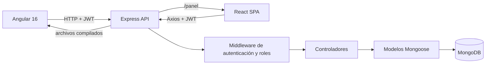

# Arquitectura técnica

## Flujo de solicitud

## Capas y responsabilidades

- `backend/src/routes`: declara endpoints y aplica autenticación y roles.
- `backend/src/controllers`: valida la petición, cifra credenciales, emite/revoca JWT y coordina operaciones CRUD.
- `backend/src/models`: define `Producto` y `Usuario`; `passwordHash` no se devuelve en consultas ordinarias.
- `backend/src/middleware/autenticacion.js`: valida firma, expiración, emisor, audiencia y versión de sesión del JWT.
- `frontend/src/app`: Angular con formularios reactivos, guards funcionales e interceptor Bearer.
- `panel-react/src`: React con componentes funcionales, React Router, estado global Context y cliente Axios.
- `backend/public`: artefactos generados por los builds de Angular y React.

## Autorización

`admin` puede gestionar productos y usuarios; `editor` puede gestionar productos; `viewer` solo puede consultar. Express valida los permisos aunque el cliente oculte las acciones. El correo indicado en `ADMIN_EMAIL` crea la cuenta admin; si la variable está vacía, el primer registro recibe ese rol.

## Persistencia y sesión

Los dos clientes consumen `/api/productos` y `/api/auth`. Las contraseñas se procesan con bcrypt. Los JWT tienen emisor/audiencia, vencimiento y `tokenVersion`; al cerrar sesión o cambiar el rol de un usuario se incrementa la versión guardada para invalidar sus tokens previos.
